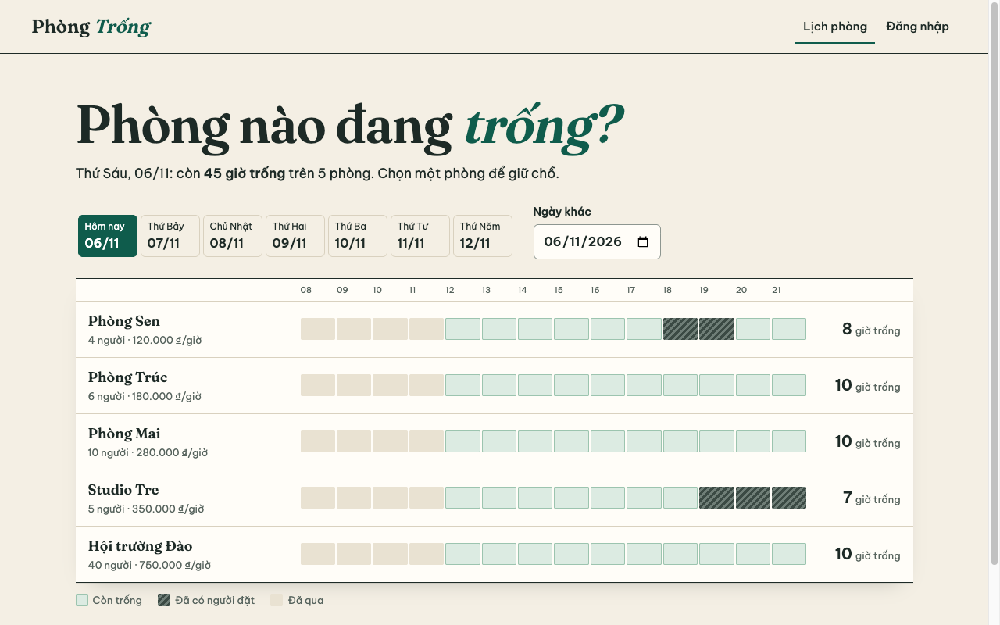
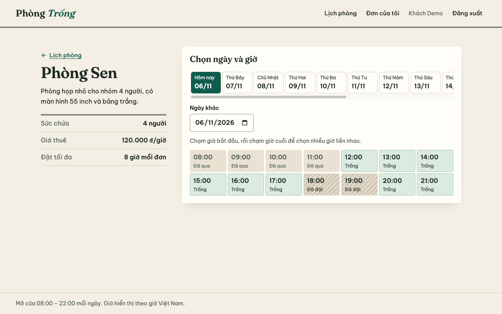
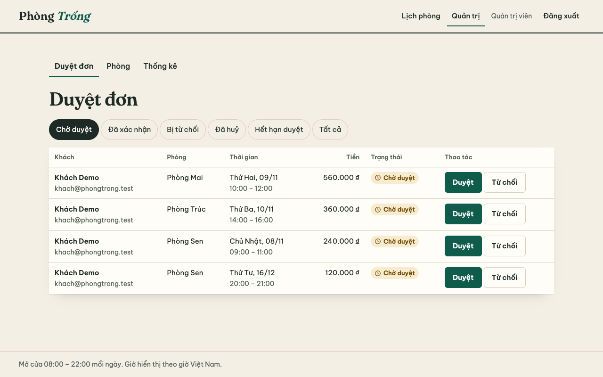
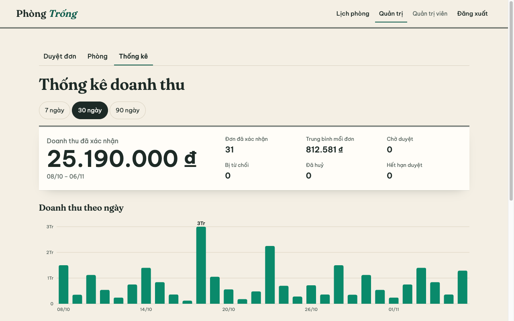

# Phòng Trống

Ứng dụng đặt phòng theo giờ. Khách xem lịch trống của từng phòng, chọn khung giờ và gửi đơn. Quản trị viên duyệt đơn, cập nhật trạng thái phòng và xem thống kê doanh thu.

Đây là dự án luyện tập. Tên phòng, giá và các đơn trong dữ liệu mẫu đều là dữ liệu giả.

## Giao diện

| Lịch trống theo ngày | Chọn giờ đặt phòng |
|----------------------|--------------------|
|  |  |

| Duyệt đơn | Thống kê doanh thu |
|-----------|--------------------|
|  |  |

## Chức năng

| Vai trò | Có thể làm |
|---------|-----------|
| Khách vãng lai | Xem lịch trống của tất cả phòng theo ngày |
| Khách đã đăng nhập | Đặt 1–8 giờ liền nhau, xem đơn của mình, huỷ đơn chưa bắt đầu |
| Quản trị viên | Duyệt hoặc từ chối đơn, thêm phòng, sửa giá, chuyển bảo trì, xem doanh thu theo ngày và theo phòng |

Lịch mở cửa 08:00–22:00, đặt trước tối đa 60 ngày, mỗi tài khoản giữ tối đa 5 đơn chờ duyệt. Đơn chờ duyệt tự hết hạn sau 24 giờ, hoặc khi tới giờ bắt đầu, và trả lại khung giờ. Giờ tính theo Việt Nam (UTC+7).

## Công nghệ

- **Client:** React 19, TypeScript, Vite, React Router, TanStack Query. Biểu đồ doanh thu tự vẽ bằng SVG.
- **Server:** Node.js, Express 5, TypeScript, zod, JWT trong cookie httpOnly.
- **Cơ sở dữ liệu:** PostgreSQL, viết SQL trực tiếp bằng `pg`, không dùng ORM.

## Cách xử lý các tình huống khó

| Tình huống | Cách xử lý |
|------------|-----------|
| Hai người đặt cùng một giờ | Ràng buộc `EXCLUDE USING gist` trên `(room_id, during)` để chính database chặn đơn trùng. Có test gửi 20 yêu cầu đồng thời, chỉ một đơn được tạo |
| Đơn nối tiếp nhau | `tstzrange` dạng `[)`, đơn 10–12 giờ không trùng đơn 12–14 giờ |
| Deadlock khi tranh cùng khung giờ | Bắt mã lỗi `40P01` và thử lại tối đa 4 lần |
| Hai quản trị viên cùng duyệt một đơn | `SELECT ... FOR UPDATE`, người sau nhận lỗi 409 |
| Một tài khoản gửi nhiều đơn song song | `pg_advisory_xact_lock` theo tài khoản trước khi đếm, nên không vượt quá 5 đơn chờ duyệt |
| Chuyển bảo trì đúng lúc có đơn mới | Khoá `FOR SHARE` trên dòng phòng khi tạo và duyệt đơn |
| Đơn chờ duyệt bị bỏ quên | Mỗi phút server chuyển các đơn quá hạn sang `expired`. Ràng buộc chống trùng chỉ xét `pending` và `confirmed`, nên khung giờ được trả lại ngay |
| Đổi giá sau khi đã đặt | Lưu giá vào `total_vnd` lúc tạo đơn, đơn cũ không đổi |
| Doanh thu theo ngày | Chỉ tính đơn đã xác nhận, nhóm theo ngày Việt Nam, ngày trống vẫn hiện giá trị 0 |

## Chạy trên máy

Cần Node.js 22.12 trở lên (yêu cầu của Vite 8, đã chạy thử trên Node 25). Không cần cài PostgreSQL: gói `embedded-postgres` tự chạy một PostgreSQL thật trong `server/.pgdata`.

```bash
npm install
cp .env.example .env
npm run dev
```

Mở http://localhost:5173. Lần chạy đầu sẽ tự tạo bảng và nạp dữ liệu mẫu.

| Tài khoản mẫu | Email | Mật khẩu |
|---------------|-------|----------|
| Quản trị viên | `admin@phongtrong.test` | `admin-local-123` |
| Khách | `khach@phongtrong.test` | `khach-local-123` |

Các tài khoản này chỉ dùng ở máy cá nhân. `npm run db:setup` chỉ dành cho database đang chạy sẵn, ví dụ khi trỏ `DATABASE_URL` tới PostgreSQL có sẵn.

## Kiểm thử

```bash
npm test
npm run coverage -w server
npm run typecheck
```

Test của server chạy trên PostgreSQL thật ở cổng 54391, không mock database.

## Chạy production

```bash
npm run build
NODE_ENV=production npm start
```

Server phục vụ luôn `client/dist`. Cần đặt ba biến:

| Biến | Giá trị |
|------|---------|
| `DATABASE_URL` | Chuỗi kết nối PostgreSQL |
| `JWT_SECRET` | Ít nhất 32 ký tự, tạo bằng `openssl rand -hex 32` |
| `TRUST_PROXY` | `0` nếu không có reverse proxy, nếu có thì là số proxy phía trước |

Trừ khi `NODE_ENV=development`, server coi mọi môi trường là production: từ chối khởi động nếu thiếu `TRUST_PROXY` hoặc secret còn giá trị mẫu. `db:setup` cũng từ chối nạp mật khẩu mẫu vào database không nằm trên máy cá nhân.

Bản production phải chạy qua HTTPS vì cookie có cờ `Secure`, và server gửi HSTS cùng `upgrade-insecure-requests`.

## Hạn chế đã biết

- Chưa có thanh toán, email thông báo hay chức năng quên mật khẩu.
- `embedded-postgres` đang là bản beta (`18.6.0-beta.19`), chỉ dùng cho môi trường phát triển và test.
- Mật khẩu băm bằng bcryptjs. Argon2id tốt hơn nếu triển khai thật.
- Múi giờ cố định UTC+7, không hỗ trợ cơ sở ở múi giờ khác.
- Giới hạn đăng nhập và đăng ký lưu trong bộ nhớ, không dùng chung được khi chạy nhiều tiến trình.
- Email chưa được xác minh, nên nhiều tài khoản từ nhiều IP vẫn có thể chiếm chỗ, mỗi đơn tối đa 24 giờ.
- Đăng xuất chỉ xoá cookie. JWT đã bị lộ vẫn dùng được tới khi hết hạn sau 7 ngày.
- Đăng ký bằng email đã có trả lỗi 409, nên có thể dò email tồn tại (đã giới hạn số lần theo IP).
- Chưa có test end-to-end tự động. Luồng trên trình duyệt được kiểm tra thủ công.

## Liên quan

- [Lược đồ database](server/migrations/001_init.sql)
- [Biến môi trường](.env.example)
